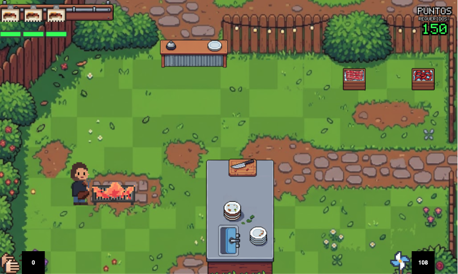

# Wollok Game: Nombre del Juego

**Grupo:** Gordos compu

**Integrantes:**
- Matias Ferrari Mazzeo
- Ramiro Agustin Albornoz 
- Hanz Alex Winkler
- Luca Salviani 
- Ayelen Samarra

## Consignas

Todo lo que necesitan saber está explicado en [este documento](https://docs.google.com/document/d/1KoB12RIZk_xPhmnOJ-EfLIPNwkETD_EaYMp2srDu9QY/edit?tab=t.0#heading=h.wnm2lu4cls8j). Para todo lo demás, aseguren prestar atención a los comunicados por Discord.

Revisen los archivos de base y cambien lo que quieran para ajustarlo a sus necesidades. Lo primero que deberían hacer es actualizar 

Recuerden que para cada checkpoint hay [expectativas mínimas](https://docs.google.com/document/d/1KoB12RIZk_xPhmnOJ-EfLIPNwkETD_EaYMp2srDu9QY/edit?tab=t.0#heading=h.56t0qdv908v3) respecto a los conceptos aplicados. Procuren:
- Validar su idea con el equipo docente que corresponda por su canal de Discord
- Para cada checkpoint, asegurar que implementaron lo necesario para esa instancia, y crear un **tag** en el repositorio para facilitar la comparación entre versiones final e intermedias.
- Para la demo final, crear un nuevo tag **demo** y actualizar este README con todo lo necesario.

# Cómo jugar

Al principio del juego nos encontraremos con el menú principal, en el cual podremos ver los controles del juego y seleccionar la `dificultad` con la que queramos comenzar a jugar. 

Con las flechas te podés mover dentro de los límites del tablero de juego, serás capaz de agarrar los materiales que necesites para completar los pedidos de los quisquillosos comensales, los cuales te pedirán `asados` y `choris`. Por un lado podrás obtener una tira de asado, pero no le vamos a dar una tira de asado entera al cliente, no pagó tanto y no nos da el presupuesto para darle la tira entera, entonces la tendremos que cortar para dársela, por otro lado, si cortás un chori, *sos un rata*, el mismo lo podremos poner directamente sobre las brasas.

Ya teniendo nuestro `chori` y nuestro `asado` cortado, tendremos que prender la parrilla (qué pensabas, que se cocinaban por arte de magia?), la cual estará apagada en un comienzo y al `avivar` el fuego la iremos prendiendo, teniendo tres posibles estados `bajo`, `medio` y `fuerte` (no podés seguir avivando más el fuego que se me descompensa el gordo), pero la diversion no acaba aqui! ya que tenemos que tener cuidado con lo que pusimos en la parrilla, el parrillero no es perfecto y si se desconcentra un poco se le puede quemar la carne... esto dependerá también de qué *tan fuerte* se encuentre el fuego de la parrilla, por ejemplo si ponemos un asado en la parrilla con fuego `bajo` tendremos más tiempo para que lo podamos sacar antes de que se queme, en cambio si el fuego está `fuerte` tendremos un margen mucho menor. Finalmente, como buen parrillero que se respeta, tendremos que estar al tanto del fuego de la parrilla ya que a medida que avanza el tiempo se va a ir apagando lentamente, bajando su intensidad. 

Pensaste que no había más, verdad? pues no, sobre todo esto tenemos los famosos eventos...perdón, me comunican por cucaracha que por motivos de presupuesto y tiempo solo tenemos un `evento`. Pero no se decepcione este evento es de lo más interesante!, en un momento al *azar* dentro de la partida, comenzará una ventisca, la cual ocasionará que se apague *más rápido el fuego de la parrilla* y *nos cueste más avivarla* complicando las cosas...

Para poder completar el juego es necesario superar los *puntos requeridos* para pasar el nivel dependiendo de su nivel de dificultad. 

Además hay un pequeño easter egg...oculto (bocaa que grande bocaaa)

## Objetivo

Sos el asador más legendario de Buenos Aires, será tu deber deleitar a los comensales siguiendo sus exigentes pedidos dentro de un entorno completamente descabellado, en tiempo récord, para así demostrar de una vez por todas que como vos, gordo parrillero legendario, no hay ninguno.

## Controles

### jugando

| teclas | acciones |
|:----:|:----:|
| &uarr; | Mover hacia arriba |
| &darr; | Mover hacia abajo |
| &larr; | Mover hacia la izquierda |
| &rarr; | Mover hacia la derecha |

Agarrar y soltar elementos <kbd>e</kbd>

#### Interacciones con la parrilla:  

Avivar el fuego: <kbd>a</kbd> (varias veces)

#### Interacciones con la tabla de corte:  

Luego de soltar un objeto, para cortarlo: <kbd>a</kbd> (varias veces)

### Al terminar el nivel  

reiniciar el nivel: <kbd>r</kbd>  

# Explicaciones

Las explicaciones teóricas y diagramas van a encontrarse en [explicaciones.md](explicaciones.md) a partir del Checkpoint #2.
